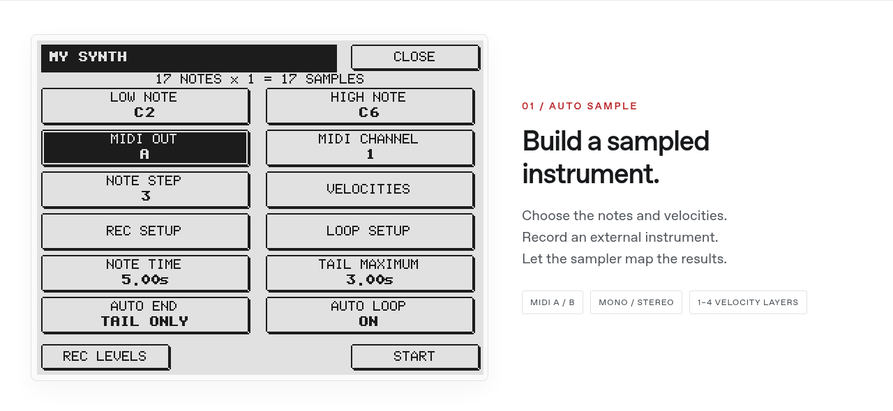
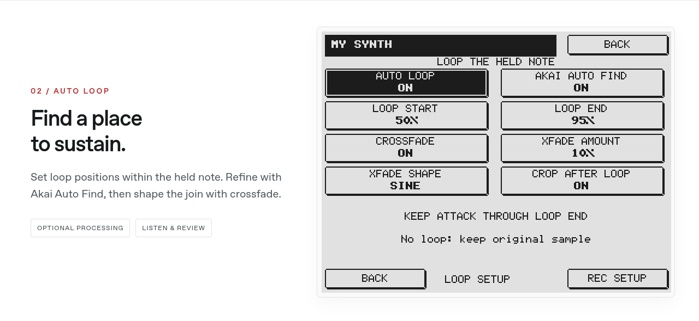
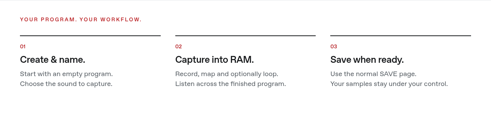
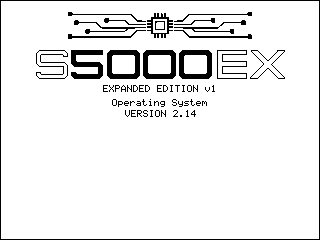
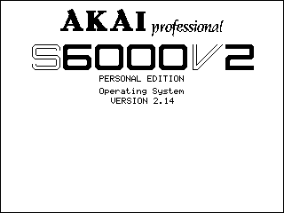

# S56K Expanded Edition

**Classic hardware. New ways to capture sound.**

Bring an external instrument into your S5000 or S6000 as a playable program. **Auto Sample** records a range of notes and velocity layers, names the samples and maps them for you. **Auto Loop** prepares the sustain with optional Akai Auto Find, crossfade and cropping. You stay in control of the sound—and when it is saved.

**[Get started](docs/QUICK-START.md) · [User guide](docs/USER-GUIDE.md) · [PDF manual](docs/S56K-Expanded-Edition-User-Guide.pdf) · [What's in v1](releases/v1.md) · [Installation](docs/INSTALLATION.md)**

> **Version 1 documentation · Firmware download not published.**
> This is the home for the manual, release information and artwork. See the [release area](releases/README.md) for download availability and [compatibility](docs/COMPATIBILITY.md) for verification details.

### From a sound to an instrument

Choose a patch, set the note range and spacing, and capture up to **four velocity layers**. MIDI outputs use the familiar **A / B** labels. Notes use musical names, and the recording-count summary tells you the size of the run before you start.

Use **REC LEVELS** to set gain and mono/stereo. Set the start threshold to catch the attack, then let **AUTO END** finish a quiet release early—or shorten a naturally decaying note too. The progress screen follows each capture, and cancellation keeps completed assignments in RAM.

**[Make your first capture →](docs/QUICK-START.md)**

### A sustain worth keeping

Place the loop within the held part of the note. Optional **AKAI AUTO FIND** refines the join locally; **CROSSFADE** offers LINEAR, LOG and SINE shapes. Keep the held-note recording or crop after the loop, while preserving the attack.

Listen to each result. If loop preparation is unsuccessful, the original recording remains available for review. The ordinary sample editor is there for finishing touches.

**[Explore the loop controls →](docs/USER-GUIDE.md#6-loop-the-sustained-part)**

### Built around the sampler

| Feature | What it brings to your workflow |
| --- | --- |
| **Automatic capture** | Musical note names, adjustable spacing, MIDI channel and output A/B. |
| **Velocity layers** | One to four capture velocities with automatic playback-zone mapping. |
| **Recording setup** | Native input meters, gain, mono/stereo and an adjustable start threshold. |
| **Flexible endings** | OFF, TAIL ONLY and NOTE + TAIL, with quiet and minimum-time controls. |
| **Optional loop preparation** | Percentage positions, local Auto Find, crossfade amount/shape and cropping. |
| **Clear progress** | Current note, velocity, layer, completed samples and loop-review counts. |
| **Focused pages** | Only active velocity rows and applicable recording/loop controls appear. |
| **EX startup artwork** | Model-specific S5000 EX / S6000 EX logos and EXPANDED EDITION v1. |

**Saving stays in your hands.** Create and name an empty program first. Auto Sample populates it in RAM; use the normal **SAVE** page to save the program **with its samples** when you are ready.

### A new identity for both models

| S5000 EX | S6000 EX |
| :---: | :---: |
|  |  |

One firmware image selects the right artwork for your sampler. The separate **Operating System VERSION 2.14** field remains unchanged for compatibility.

**[View the screen gallery →](docs/SCREEN-GALLERY.md)**

### Everything you need to get started

| Guide | Start here for… |
| --- | --- |
| **[Quick start](docs/QUICK-START.md)** | Your first recording, from connecting cables to saving a program. |
| **[Illustrated manual](docs/USER-GUIDE.md)** · **[PDF](docs/S56K-Expanded-Edition-User-Guide.pdf)** | Notes, layers, timing, loops and troubleshooting. |
| **[Installation guide](docs/INSTALLATION.md)** | Temporary floppy loading and permanent flash installation. |
| **[Version 1 release notes](releases/v1.md)** | Features, behavior and practical limits. |
| **[Compatibility](docs/COMPATIBILITY.md)** | Model support and the available software/hardware verification evidence. |
| **[Release area](releases/README.md)** | Firmware availability and how to identify the correct download. |
| **[Feedback](https://github.com/Tubbritt/S56K-Expanded-Edition/issues)** | Share your sampler, settings and observations. |

### Before installing

**Firmware installation is at your own risk.** Flashing can leave a sampler unusable and can cause data loss or repair costs. The project is provided without warranty, and liability is limited to the extent permitted by law. Read the **[full flashing disclaimer](DISCLAIMER.md)** and **[installation guide](docs/INSTALLATION.md)** before proceeding.

---

S56K Expanded Edition is an independent project, not an official AKAI release or an AKAI-endorsed product. AKAI and other product names belong to their respective owners.

The studio banner is presentation artwork adapted from the supplied image. The separate menu and boot images are native firmware renders with example settings; neither is presented as a record of hardware testing. This repository hosts documentation, artwork and release information. Firmware development source is not hosted here.
