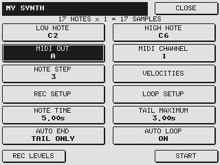

# Your first Auto Sample program

**Start with one note. Listen. Then expand the range.**

[Home](../README.md) · [Full user guide](USER-GUIDE.md)

> No firmware BIN is published here yet. These steps describe use once an appropriate Personal Edition build is running. Follow the installation and hardware-test instructions accompanying the specific release.

## 1. Connect your instrument

Connect **MIDI OUT A** on the sampler to your instrument's MIDI input. Connect the instrument's audio output to the sampler's recording input. Use both audio channels if you want stereo.

Choose the sound and its receiving MIDI channel. Keep that patch selected while sampling.

## 2. Name a fresh program

Create an **empty program** on the Akai and name it after the sound you are capturing. Open **Program Tools → Auto Sample**.

Select fields with their soft keys; edit using DATA or + / −. Start with:

| Setting | Starting point |
| --- | --- |
| LOW NOTE / HIGH NOTE | Both C3 |
| MIDI OUT | A, or the output you connected |
| MIDI CHANNEL | The instrument's receiving channel |
| VELOCITY LAYERS | 1, at velocity 100 |
| NOTE TIME | 3 seconds |
| TAIL MAXIMUM | 2 seconds; increase for a long release |
| AUTO END / AUTO LOOP | Both OFF |

Akai calls MIDI note 60 **C3**; another keyboard may display C4 for the same pitch.

## 3. Check the audio

Open **REC LEVELS**. Select MONO or STEREO, choose the recording source and set gain. Use **TEST NOTE**, watch the meters and avoid clipping. The mono/stereo choice stays selected when you return.

In **REC SETUP**, set START LEVEL above background noise but below the sound's attack. Leave generous free sample RAM.

## 4. Capture and listen

Return to the main page and press **START**. The sampler triggers the note, records the audio and adds the sample to your program in RAM.

Play it back and check the attack, level, pitch and release. Use another empty program for a further test.

## 5. Expand the sound

Start a fresh program and widen LOW NOTE/HIGH NOTE. NOTE STEP 3 samples every three semitones. Add velocity layers for changes in playing strength.

For a sustained patch, try AUTO END **TAIL ONLY** to retain the full held note while ending a quiet tail early. Optional AUTO LOOP can prepare a sustain; the [loop guide](USER-GUIDE.md#6-loop-the-sustained-part) explains percentages, Auto Find, crossfade and cropping.

## 6. Save it yourself

Listen across the completed program, then use the ordinary **SAVE** page to save the program **with its samples**. Auto Sample never saves the recordings to disk automatically.

Avoid simultaneous ak.Sys/SysEx sample editing during Auto Loop. CANCEL retains completed assignments in RAM.
