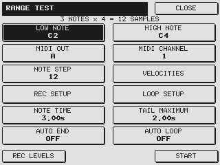
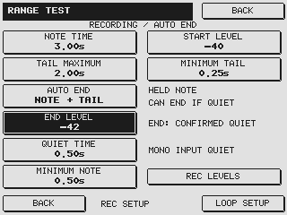
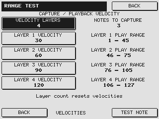
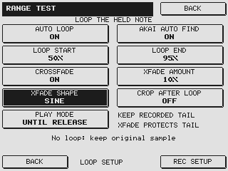
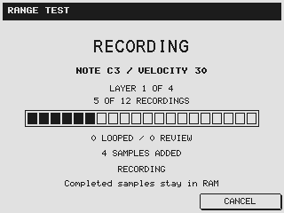
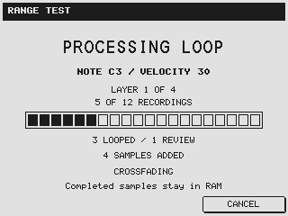
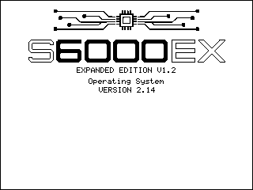

# S56K Expanded Edition · Screen gallery

[Home](../README.md) · [User guide](USER-GUIDE.md) · [Quick start](QUICK-START.md)

From the first note to the finished program, these are the V1.2 screens you use on the sampler. Images are native firmware renders at 320 × 240 pixels, with example settings and progress states. Click an image to inspect it.

## Set up a capture

Musical note names, rear-panel MIDI A/B labels, a recording-count summary and consistent submenu buttons. Version numbers stay out of the Auto Sample interface.

## Choose when to stop

Auto End reveals the controls that apply to the chosen mode. Hidden values are retained for when you enable them again.

## Add playing dynamics

The four-layer example captures velocities 30, 60, 90 and 120. Capture velocity and playback range are shown separately. Reducing the layer count hides the unused rows.

## Prepare the sustain

Percentage positions define the initial loop within the held note. Akai Auto Find can refine it locally. **CROP AFTER LOOP OFF** keeps the recorded release, and **PLAY MODE** chooses UNTIL RELEASE or IN RELEASE. Crossfade is shortened when needed to protect the retained tail. Only the enabled controls appear. The waveform can be inspected in the sample editor after capture.

## Follow the run

The progress screen follows recording and processing. Between notes, **WAITING FOR SAMPLE MEMORY** or **ORGANISING SAMPLE MEMORY** indicates that recording space is being prepared. With Crop OFF, the final extraction stage reads **FINALIZING SAMPLE**. Completed assignments remain in RAM when you cancel; cleanup finishes before another capture can start, and saving stays manual.

## A new startup for both models

| S5000 EX | S6000 EX |
| --- | --- |
|  |  |

A shared CPU/circuit graphic, clean outlined EX lettering and **EXPANDED EDITION V1.2** give the update its own identity. Each sampler displays its correct model name. The separate **Operating System VERSION 2.14** field remains unchanged for compatibility.

---

The native renders show implemented drawing behavior; they are not photographs of a physical LCD or records of a completed capture session. See [Compatibility](COMPATIBILITY.md) for the available hardware and software verification evidence.
