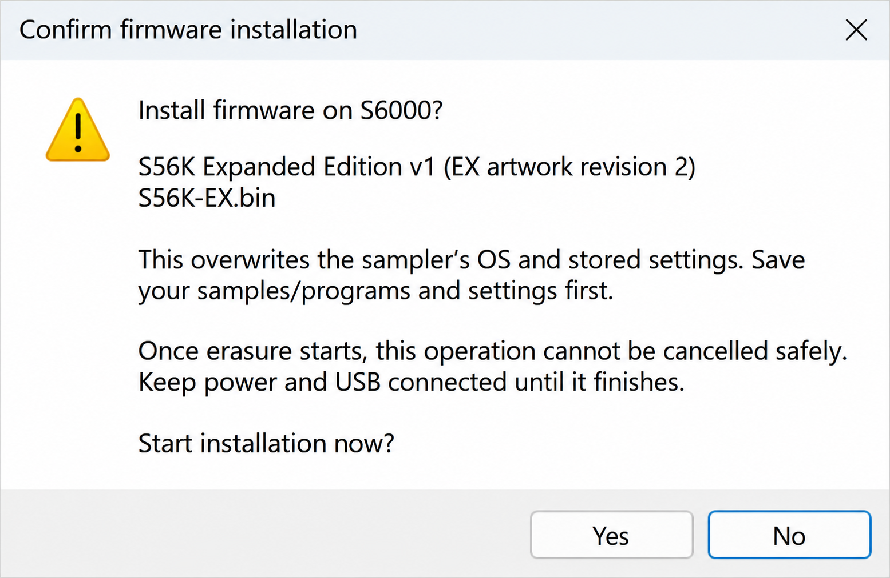
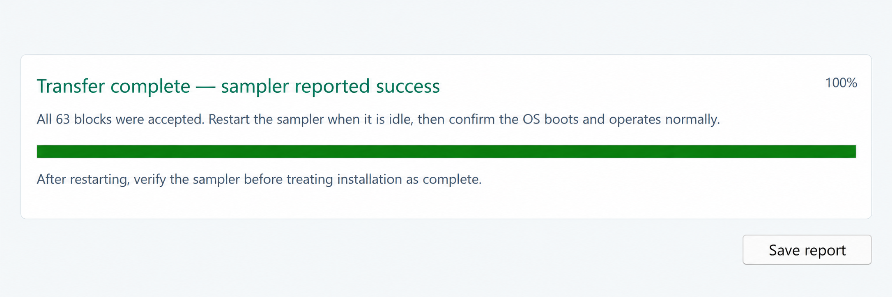

# Update your sampler from Windows

[Home](../README.md) · [Download updater](https://github.com/Tubbritt/S56K-Expanded-Edition/raw/refs/tags/updater-v1.0-rc1/releases/updater/1.0-rc1/S56K-Firmware-Updater-1.0-RC1-win64.zip) · [Download S56K-EX.bin](https://github.com/Tubbritt/S56K-Expanded-Edition/raw/refs/tags/expanded-v1/releases/firmware/v1/S56K-EX.bin) · [Troubleshooting](USB-REFERENCE.md#troubleshooting)

**Windows 11 x64 · S5000/S6000 with an IB-S56USB card · Microsoft WinUSB.** Extract the updater ZIP, then open `S56K-Firmware-Updater.exe`. Firmware is a separate download. This is an unsigned **1.0 RC1** app; see [compatibility](COMPATIBILITY.md) for test coverage.

## Driver setup · once only

**Already connects? Skip ahead.** Otherwise, find the Akai device in Device Manager and choose:

**Update driver → Browse my computer → Let me pick → Universal Serial Bus devices → WinUsb Device → Next.**

Check you selected the Akai device (`USB\VID_09E8&PID_005E`). Reconnect USB, then click **Refresh → Connect**. If WinUsb Device is unavailable or no interface is found, see the [optional driver fallback](USB-REFERENCE.md#driver-fallback-winusb-unavailable-or-no-registered-interface).

## 1. Connect and choose your BIN

Select the sampler and click **Connect**, then **Choose BIN…** and select `S56K-EX.bin`. Look for **Connected**, **Exact SHA-256 match** and **Ready to install**.

*Illustrations adapted from the supplied Windows screenshots.*

## 2. Confirm the installation

Save your programs, samples and settings first. Start with a freshly booted sampler and no loaded libraries. Close ak.Sys and other USB tools. Read the [flashing disclaimer](../DISCLAIMER.md).

Click **Install firmware**, check the sampler and firmware shown, then choose **Yes** when ready.

**This writes flash and stored settings. Keep power and USB connected until it finishes. There is no safe cancellation after erasure starts.**

## 3. Finish, restart and check

Wait for **Transfer complete — sampler reported success**. Save the report.

When the sampler is idle, **remove any firmware floppy and restart it**. Check the EX boot artwork and **Program Tools → Auto Sample**. The ordinary version field still reads 2.14.

Close and reopen the app before another update. If an update reports an error after erasure starts, leave the sampler powered on initially and [follow the failure guidance](USB-REFERENCE.md#troubleshooting).

[Checksums & supported files](USB-REFERENCE.md#supported-files) · [Troubleshooting](USB-REFERENCE.md#troubleshooting) · [Compatibility and test status](COMPATIBILITY.md)
