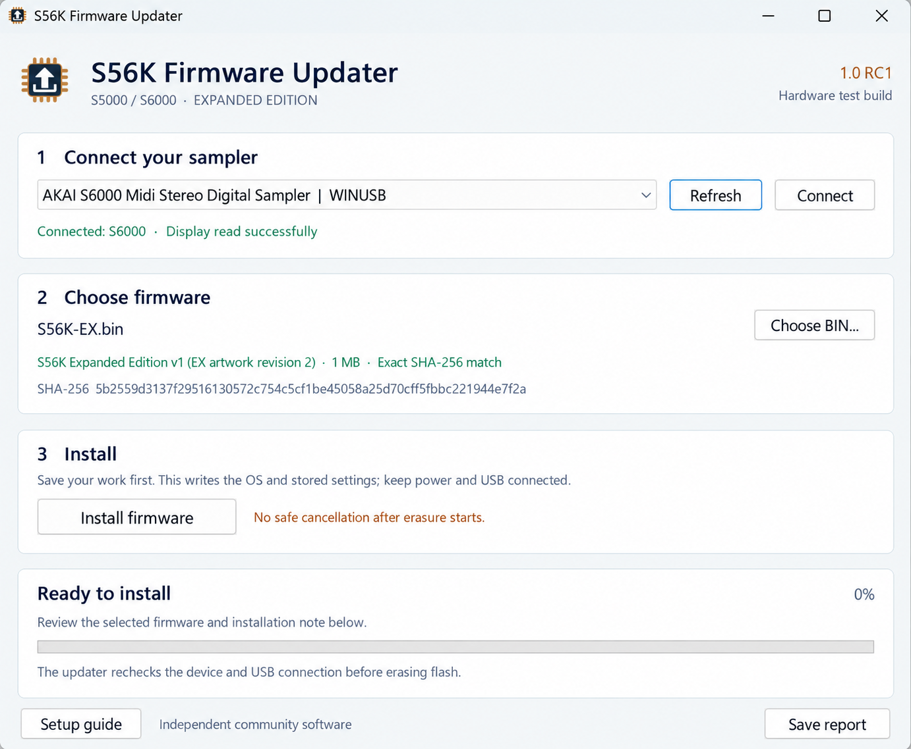
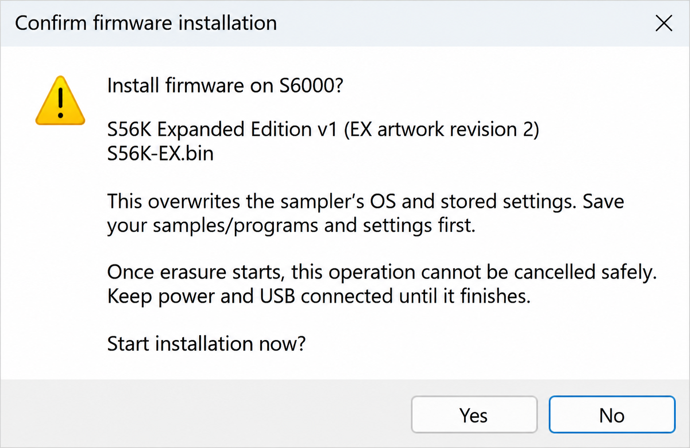
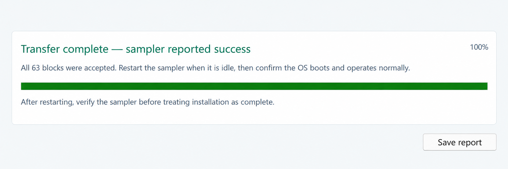

# Update your sampler from Windows

[Home](../README.md) · [Download updater 1.1 RC1](https://github.com/Tubbritt/S56K-Expanded-Edition/raw/refs/tags/updater-v1.1-rc1/releases/updater/1.1-rc1/S56K-Firmware-Updater-1.1-RC1-win64.zip) · [Floppy installation](INSTALLATION.md) · [Troubleshooting](USB-REFERENCE.md#troubleshooting)

**Firmware Updater 1.1 RC1 supports Expanded Edition V1.2, V1.1, V1 and original Akai OS 2.14.** It checks the complete BIN against the approved checksum for that edition. If you still have updater 1.0 RC1, download the new app to install V1.1 or V1.2.

**Windows 11 x64 · S5000/S6000 with an IB-S56USB card · Microsoft WinUSB.** Extract the entire updater ZIP, then open `S56K-Firmware-Updater.exe`. Firmware is a separate download. This is an unsigned release candidate; see [compatibility](COMPATIBILITY.md) for test coverage.

## Driver setup · once only

**Already connects? Skip ahead.** Otherwise, open **USB driver setup** in the app. The assistant lists present Akai devices and their current driver association, including devices that cannot yet be opened through WinUSB.

Select your sampler, then choose **Change Windows driver…** to open Windows' driver wizard. This explicit action requests administrator approval; ordinary updater use does not require elevation. In the wizard, choose:

**Browse my computer → Let me pick → Universal Serial Bus devices → WinUsb Device (Microsoft) → Next.**

Check that you selected the Akai device (`USB\VID_09E8&PID_005E`). The assistant displays the local `winusb.inf` path when available for **Have Disk**. It does not silently choose a driver or install one on another device. Recheck afterward, close the assistant and click **Refresh → Connect**. The same steps remain available through Device Manager.

If WinUsb Device is unavailable or no usable interface is found, see the [optional driver fallback](USB-REFERENCE.md#driver-fallback-winusb-unavailable-or-no-registered-interface). Changing the driver association can affect original ak.Sys access.

## 1. Connect and choose your BIN

Select the sampler and click **Connect**, then **Choose BIN…** and select the [V1.2 firmware](../releases/v1.2.md) or another exact [supported image](USB-REFERENCE.md#supported-files). Look for **Connected**, the correct edition name, **Exact SHA-256 match** and **Ready to install**. V1.2 must be identified as **Expanded Edition V1.2**.

*Illustrations show the same installation workflow using the earlier Expanded V1 app/screens. The current app identifies the selected edition; these illustrations are not evidence of a new hardware test.*

## 2. Confirm the installation

Save your programs, samples and settings first. Start with a freshly booted sampler and no loaded libraries. Close the Editor, ak.Sys and other USB tools. Read the [flashing disclaimer](../DISCLAIMER.md).

Click **Install firmware**, check the sampler and firmware shown, then choose **Yes** when ready.

**This writes flash and stored settings. Keep power and USB connected until it finishes. There is no safe cancellation after erasure starts.**

## 3. Finish, restart and check

Wait for **Transfer complete — sampler reported success**. Save the report.

When the sampler is idle, **remove any firmware floppy and restart it**. For the current firmware, confirm **EXPANDED EDITION V1.2** on startup and **Program Tools → Auto Sample**. If installing an earlier Expanded edition, check that edition's caption. For factory restoration, check the original Akai startup and ordinary operation. The underlying version field reads **2.14** for all supported images, so it does not identify the Expanded edition.

Close and reopen the app before another update. If an update reports an error after erasure starts, leave the sampler powered on initially and [follow the failure guidance](USB-REFERENCE.md#troubleshooting).

[Checksums & supported files](USB-REFERENCE.md#supported-files) · [Troubleshooting](USB-REFERENCE.md#troubleshooting) · [Compatibility and test status](COMPATIBILITY.md)
