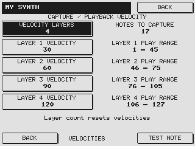
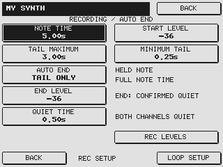
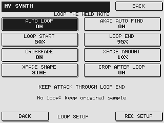
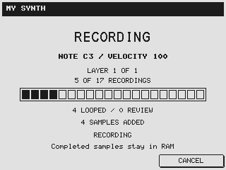
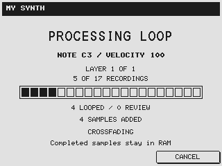

# S56K Expanded Edition · User guide

**Turn an external instrument into an Akai program, one note at a time.**

**Version 1 · AKAI S5000 / S6000**

[Home](../README.md) · [Quick start](QUICK-START.md) · [PDF manual](S56K-Expanded-Edition-User-Guide.pdf) · [Installation](INSTALLATION.md)

Read the [installation guide](INSTALLATION.md), [compatibility notes](COMPATIBILITY.md) and [risk disclaimer](../DISCLAIMER.md) before loading or installing firmware.

Auto Sample sends MIDI notes to an external instrument, records its audio and assigns the recordings to the current program. You choose the pitches, velocity layers and recording behaviour. Optional Auto Loop processing prepares sustained samples after each recording.

**Create and name the program first → capture into RAM → listen and edit → save manually.**

The screen images show the implemented interface at its native resolution. They are firmware renders with example names, settings and progress states; physical LCD appearance may differ.

## 1. Connect and prepare

Connect the sampler's **MIDI OUT A or B** to the instrument's MIDI input. Connect the instrument's audio output to the sampler's recording input: left input for a mono capture, or both left and right for stereo. Select the appropriate input source using the normal recording controls.

Choose the sound on the instrument, set its receiving MIDI channel and leave that sound selected throughout the run.

Create an **empty program**, give it a useful name and open **Program Tools → Auto Sample**. The initial empty keygroup must contain no sample assignments. A run adds its own keygroups and velocity zones. To make a second run after completing or cancelling the first, start with another empty program.

Leave generous free sample RAM. Stereo recordings and multiple velocity layers use more memory, and loop processing needs temporary copies while preserving the original recording. During a run, avoid editing samples simultaneously through ak.Sys or SysEx.

## 2. Set the capture range

Press the soft key beside a field to select it, then use the **DATA wheel** or **+ / −** to change the value. The submenu buttons open their own pages; **BACK** returns to the main setup.

| Main-page control | What it does |
| --- | --- |
| **LOW NOTE / HIGH NOTE** | First and last pitches to capture. Set both to the same note for a one-note test. |
| **MIDI OUT** | Selects physical output **A** or **B**, matching the rear-panel labels. |
| **MIDI CHANNEL** | Must match the instrument's receiving channel. |
| **NOTE STEP** | Distance between captured notes, in semitones. Smaller steps produce more recordings and less pitch shifting during playback. |
| **NOTE TIME** | Requested time to hold each outgoing note before sending Note Off. |
| **TAIL MAXIMUM** | Maximum recording time after Note Off, allowing the instrument's release and effects to fade. |
| **AUTO END** | Chooses whether quiet audio can shorten the held note, the tail, or neither. |
| **AUTO LOOP** | Enables optional loop processing after each recording. |

The summary shows pitches × velocity layers = recordings. The high endpoint is included even when the final interval is shorter than Note Step. The limit is **99 captured pitches**, with up to four layers per pitch, subject to available memory.

Note names follow the Akai convention: **MIDI note 60 is C3**. Another instrument may call the same pitch C4; match the MIDI note number.

For example, C2 to C4 with a step of 12 captures C2, C3 and C4. With four velocity layers, that produces twelve recordings. The sampler assigns playback ranges between neighbouring captured pitches across the selected low-to-high range.

## 3. Check levels and choose mono or stereo

Open **REC LEVELS** before starting a long run. This uses the sampler's existing input, gain and meter controls. Set **Record Mode** to MONO or STEREO here; the choice is retained when returning to Auto Sample.

Use **TEST NOTE** and inspect the meters at the loudest velocity you plan to capture. Adjust the instrument's output and the sampler's recording gain for a healthy signal without clipping. For stereo, check both channels.

Velocity may change the instrument's tone as well as its loudness. Recording gain controls the captured level. Set both appropriately for the sound.

**START LEVEL**, available in REC SETUP and through the native recording controls, determines when incoming audio triggers recording. Set it above the background noise but low enough to catch the intended attack. A slow or very quiet sound may need a lower threshold. Test one note and inspect its beginning before recording the entire range.

## 4. Capture velocity layers

Open **VELOCITIES** and choose one to four layers. Each layer specifies the MIDI velocity sent to the instrument. The displayed **PLAY RANGE** shows which incoming velocities will select that layer when you play the completed Akai program. Only the selected number of layers is displayed: with one layer, the other three rows are hidden.

Changing the layer count resets the capture velocities to a starting arrangement. Adjust them afterwards to suit the instrument. Velocities must increase from layer to layer; the controls maintain that order.

With four layers, the starting values are 30, 60, 90 and 120. Their playback ranges are divided at the midpoints, covering velocities 1–127 without gaps. Select a layer and use **TEST NOTE** to audition that velocity at the current low note.

Each pitch gets one keygroup, with its recordings placed in the appropriate velocity zones. Sample names include a shortened program-name prefix, the note and the capture velocity. Longer names are shortened to fit the sampler's naming limit.

## 5. Decide when recording should end

**NOTE TIME** covers the held note. **TAIL MAXIMUM** covers the sound after the external instrument receives Note Off. A sustained pad may keep sounding while held, then take several seconds to release. A guitar or piano sound may decay to silence while the note is still held.

| AUTO END setting | Held note | Release tail |
| --- | --- | --- |
| **OFF** | Uses the full Note Time. | Uses the full Tail Maximum. |
| **TAIL ONLY** | Uses the full Note Time. | Can stop early after confirmed quiet. |
| **NOTE + TAIL** | Can send Note Off early after the sound has been heard and then becomes quiet. | Can also stop early after confirmed quiet. |

For sustained sounds that you intend to loop, **TAIL ONLY** is a useful starting point. It preserves the requested held duration while avoiding an unnecessarily long silent release. For naturally decaying sounds, **NOTE + TAIL** can save time across a large run.

When Auto End is enabled, REC SETUP exposes:

- **END LEVEL:** the level at or below which audio counts as quiet.
- **QUIET TIME:** how long that quiet condition must persist before it qualifies as an ending.
- **MINIMUM TAIL:** the earliest point after Note Off at which quiet can end the tail.
- **MINIMUM NOTE:** available in NOTE + TAIL mode; prevents quiet detection from shortening the held note before this time.

In stereo, **both channels must be quiet**. This helps retain a release or effect that continues on only one side. Longer Quiet Time is useful for sounds with rhythmic gaps, tremolo or delays.

The end detector uses the sampler's coarse meter scale. **METER FLOOR** is its lowest detection bucket, not a precision dBFS measurement. Choose a setting by listening to a test recording and observing the actual noise floor. A lower end threshold may preserve more decay, but noise can prevent it from being reached.

Unavailable controls disappear. Their values remain stored and reappear when the relevant mode is enabled. Auto End changes recording behaviour; it does not switch Auto Loop on or off.

## 6. Loop the sustained part

Enable **AUTO LOOP** and open **LOOP SETUP**. Its percentages refer to the **captured held-note portion**, starting at the sample's playback start and ending before the external release tail. They do not include the tail in their measurement.

| Loop control | Meaning |
| --- | --- |
| **LOOP START** | Initial loop-start position, from 1% to 98% of the held portion. |
| **LOOP END** | Initial loop-end position, from 2% to 99%, above Loop Start. |
| **AKAI AUTO FIND** | Optionally refines the initial loop locally using Akai's existing routine. |
| **CROSSFADE** | Optionally processes the join using the native crossfade function. |
| **XFADE AMOUNT** | Requested crossfade length as a percentage of the resulting loop length. |
| **XFADE SHAPE** | Selects LINEAR, LOG or SINE. |
| **CROP AFTER LOOP** | Chooses how much audio remains after a successful loop is prepared. |

For a steady synth tone, try a five-second Note Time, Loop Start 50%, Loop End 95%, Auto Find ON and Crossfade ON at 10%. These are starting settings, not a promise that every patch will loop cleanly. Aim for a stable section after the initial attack and before the release.

**Auto Find OFF** keeps the percentage positions as the starting loop without native refinement; the recording still has to pass the loop checks. **Auto Find ON** performs a local adjustment. It does not search every possible loop throughout the entire 50–95% region or automatically identify the musically best sustain.

Crossfade amount is limited by the available pre-loop audio and loop length. A larger percentage can smooth a join but may change the sound. Audition the curves on separate test captures. With Crossfade OFF, amount and shape are hidden.

### What happens to the tail?

| Result | Audio retained |
| --- | --- |
| **AUTO LOOP OFF** | The ordinary recorded note and tail. |
| **Successful loop, CROP OFF** | The held-note recording; the external release tail is removed. |
| **Successful loop, CROP ON** | The attack through loop end, plus the small native 15-frame playback margin. |
| **Loop rejected for review** | The original recording, including its recorded tail. |

The sampler records the external release before processing the loop. Cropping does not skip that waiting period. For the finished looped program, adjust playback release using the Akai's envelope controls.

Auto Loop checks each channel and can leave a recording unlooped for review. Listen to these results in the ordinary sample editor. Evolving pads, heavy chorus, noisy textures and rhythmic material may require different positions or manual editing. Loop Setup contains settings for the recordings you are about to make. Use the ordinary sample editor to inspect their waveforms after capture.

## 7. Run, listen and save

Press **START** on the main page. The display follows preparation, waiting for audio, recording, release and sample assignment. When looping is enabled, it also shows the processing stage and counts of looped samples and recordings requiring review.

**CANCEL** stops the run while keeping completed sample assignments in RAM. Finishing an active recording or processing operation may take a moment. The current unfinished capture may not be assigned to the program; inspect the samples in RAM if the display asks you to check them.

After completion, play across the keygroups and velocity boundaries. For looped sounds, hold notes long enough to hear several repetitions, then check the release. Review any unlooped recordings and make ordinary sample or program edits as needed.

**Save the program with its samples through the normal SAVE page.** Auto Sample does not write your sound to disk. Unsaved recordings remain dependent on RAM and are lost when the sampler is powered off. Reload a saved program to confirm that the samples and loop settings were stored as intended.

## 8. Troubleshooting

| What you notice | What to check |
| --- | --- |
| **USE AN EMPTY PROGRAM** | Create a new named program with no sample assignments. A completed or partial Auto Sample program is no longer empty. |
| MIDI plays, but there is no recorded audio | Check audio cables, input source, Record Mode, gain and Start Level. TEST NOTE and the meters help separate MIDI routing from audio routing. |
| **NO AUDIO – CHECK START LEVEL** | The audio did not reach the trigger threshold in time. Check the signal and threshold with a one-note test. |
| A recording is very quiet | Adjust audio output/recording gain while watching the meters. Check your chosen capture velocity too. |
| Decay is cut short | Lower End Level, increase Quiet Time or minimum timing, or use OFF to compare a full-duration recording. |
| The tail always uses its maximum time | Background noise may remain above End Level; in stereo, check both channels. |
| A loop is left for review | Try a steadier section, a longer held recording, different percentages or crossfade settings. The original recording is available for listening and manual work. |
| An option has disappeared | Enable its parent option: AUTO END for quiet controls, AUTO LOOP for loop controls, and CROSSFADE for amount/shape. |
| A run stops with a processing or restart message | Stop further runs, inspect the samples already in RAM and record the settings/message for feedback. Save completed work through the normal controls if they remain responsive. |

For useful feedback, include your sampler model, mono/stereo mode, source instrument, capture and loop settings, the displayed message and what you expected to hear. A photo of the relevant screen is helpful.

## 9. Expanded Edition startup

The boot screen shows a CPU/circuit graphic, the correct **S5000 EX** or **S6000 EX** model logo, and **EXPANDED EDITION v1**. The EX lettering is outlined to match the model design.

The separate **Operating System VERSION 2.14** field is retained for compatibility. Expanded Edition v1 identifies the added feature set; it does not change the underlying Akai version identity. Use the checksum accompanying a firmware download to identify its exact file.

---

[Home](../README.md) · [Quick start](QUICK-START.md) · [Installation](INSTALLATION.md) · [Compatibility](COMPATIBILITY.md) · [Risk disclaimer](../DISCLAIMER.md)
